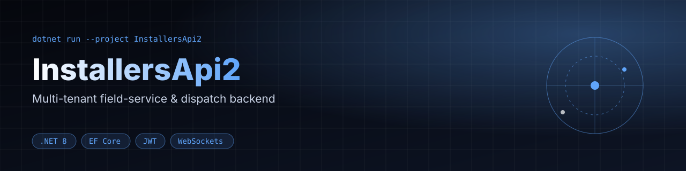
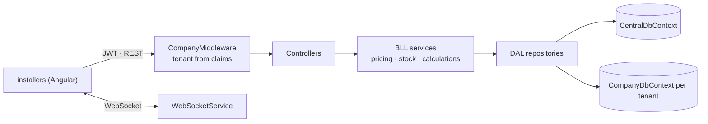

<div align="center">



[](https://github.com/Shtibel1/InstallersApi2/actions/workflows/ci.yml)


[-dd0031)](https://github.com/Shtibel1/installers)

**Multi-tenant ASP.NET Core 8 backend for field-service dispatch, stock auditing and contractor settlements.**

</div>


ASP.NET Core 8 Web API powering field-service installation workflows, contractor dispatching, equipment stock auditing, and automated contractor settlement calculations. Paired with the [`installers`](https://github.com/Shtibel1/installers) Angular frontend.

## Architecture

The solution follows a strict 3-tier architecture separating HTTP delivery, domain orchestration, and persistence:

```text
InstallersApi2.sln
├── InstallersApi2/          # ASP.NET Core 8 Web API (Controllers, JWT Auth, Middlewares, WebSockets)
├── BLL/                     # Business Logic Layer (Services, AutoMapper profiles, ViewModels, Validation)
└── DAL/                     # Data Access Layer (EF Core DbContexts, Repositories, Entities, Query Filters)
```



### Key Engineering Highlights

- **Claim-Driven Multi-Tenancy (`CompanyMiddleware` + `ICompanyDataProvider`)**: Incoming JWT tokens carry tenant scopes (`CustomClaimTypes.Companies`). `CompanyMiddleware` extracts and binds the active company context per request so repository queries isolate data across tenants (`CentralDbContext` / `CompanyDbContext`).
- **Contractor Settlement & Pricing Engine (`CalaulationsServics` / `AdditionalPriceService`)**: Computes per-installer payouts across base product installation rates, custom per-installer price overrides (`AdditionalPrice`), and assignment-level add-ons (`AssignmentAdditionalPrice`).
- **Inventory & Stock Auditing (`ServiceProductsService`)**: Tracks equipment requirements per product (`ProductRequiredServiceProduct`), field-technician stock balances (`ServiceProviderStock`), shortage detection (`ShortageVm`), and immutable stock-adjustment audit logs (`ServiceProviderStockAudit`).
- **Real-Time Dispatch Notifications (`WebSocketService` / `WebSocketController`)**: Pushes live assignment status transitions and schedule updates to connected dispatcher and installer clients over native WebSockets.
- **Centralized Exception Handling (`GlobalExceptionMiddleware`)**: Maps domain exceptions (`EntityNotFoundException`, validation failures, unauthorized tenant access) into consistent HTTP responses.

## Domain Modules & API Surface

| Controller | Responsibility |
|---|---|
| `AssignmentsController` | Field installation lifecycle, filtering (`AssignmentFilters`), scheduling, pickup status, and customer comments |
| `ServiceProvidersController` | Installer onboarding, category qualifications (`ServiceProviderCategory`), and stock balances |
| `ProductsController` & `CategoriesController` | Catalog of installable products, categories, and required service parts |
| `ServiceProductsController` | Warehouse/technician parts inventory, stock adjustments, and audit trail |
| `AdditionalsController` & `AdditionalPriceController` | Add-on work items and installer-specific pricing matrices |
| `CalculationsController` | Batch settlement runs (`Calculation`, `CalculationAssignment`) for contractor payouts |
| `EmployeesController` & `MarketersController` | Internal staff and lead-source marketer management |
| `AuthController` | ASP.NET Identity + JWT bearer authentication and role-based authorization |
| `WebSocketController` | Real-time bi-directional channel for live dispatch updates |

## Tech Stack

- **Runtime & Framework**: .NET 8 (`net8.0`), ASP.NET Core Web API
- **Data Access**: Entity Framework Core 7 (SQL Server), Repository Pattern
- **Authentication**: ASP.NET Core Identity + JWT Bearer (`Microsoft.AspNetCore.Authentication.JwtBearer`)
- **Object Mapping**: AutoMapper 12 (`MappingProfile`)
- **Real-Time**: `System.Net.WebSockets`
- **API Docs**: Swashbuckle / OpenAPI (Swagger UI in Development)
- **CI/CD**: GitHub Actions (`.github/workflows/deployProd.yml`)

## Quick start

### Prerequisites
- .NET 8 SDK
- SQL Server instance

### Setup

1. Configure your database connection string and JWT secret in `InstallersApi2/appsettings.Development.json`:
   ```json
   {
     "ConnectionStrings": {
       "DefaultConnection": "Server=localhost;Database=InstallersDb;Trusted_Connection=True;TrustServerCertificate=True;"
     },
     "JWT": {
       "Secret": "<your-development-jwt-signing-key>"
     }
   }
   ```
2. Apply Entity Framework Core migrations:
   ```bash
   dotnet ef database update --project DAL --startup-project InstallersApi2
   ```
3. Run the API server:
   ```bash
   dotnet run --project InstallersApi2
   ```
   Swagger UI is available at `https://localhost:<port>/swagger` in development mode.

## Tests

`InstallersApi2.Tests` is an xUnit + Moq suite that runs on every push and PR via GitHub Actions:

| Area | What is covered |
|---|---|
| `ConditionalRequiredAttribute` | required-when rules, member-name binding for ModelState, missing-property guard, `SignupModel` service-provider categories |
| `GlobalExceptionMiddleware` | pass-through, `EntityNotFoundException` → 404 JSON, unhandled → 500 JSON, status-code message resolver |
| `CalaulationsServics` | contractor settlement creation links every assignment and persists once |

```bash
dotnet test
```

## Roadmap

- [ ] Integration tests for tenant isolation and settlement calculations
- [ ] Docker Compose (API + SQL Server) for one-command local setup
- [ ] Migrate EF Core 7 packages to the .NET 8-aligned versions
